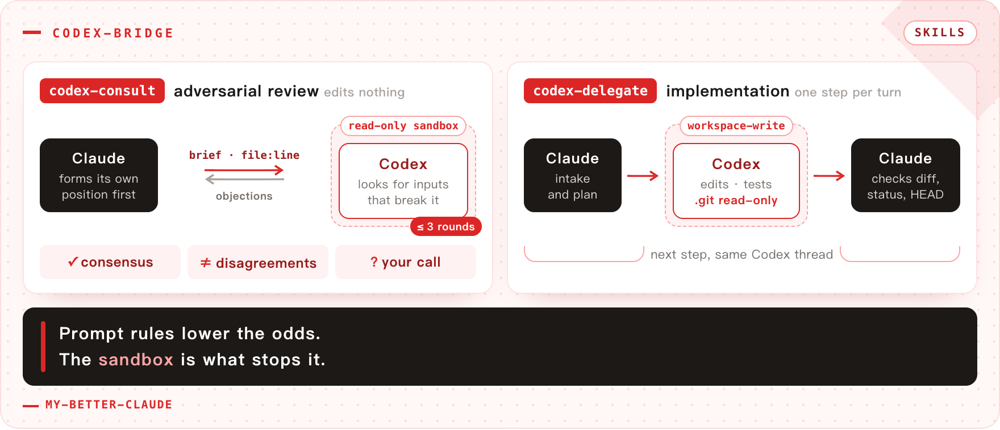

# my-better-claude

English | [中文](README.zh-CN.md)


A Claude Code plugin marketplace of things that make day-to-day Claude Code better: a look at the images you paste, a meter for the prompt cache you pay for, a queue that never steers, and a second model to argue with.

## Install

```
/plugin marketplace add francize/my-better-claude
/plugin install image-preview@my-better-claude
/plugin install cache-meter@my-better-claude
/plugin install queue@my-better-claude
/plugin install codex-bridge@my-better-claude
```

Install only the ones you want; they are independent.


| Plugin                                   | Kind   | What it does                                                                                                      |
| ---------------------------------------- | ------ | ----------------------------------------------------------------------------------------------------------------- |
| [`image-preview`](plugins/image-preview) | mod    | Hover a pasted `[Image #N]` to see the picture, while writing and on sent prompts                                 |
| [`cache-meter`](plugins/cache-meter)     | mod    | Prompt-cache meter above the prompt: read / wrote / new tokens, countdown to expiry, named misses, session totals |
| [`queue`](plugins/queue)                 | mod    | Enter while Claude works queues the prompt instead of steering; Send now, edit or cancel each from a band          |
| [`codex-bridge`](plugins/codex-bridge)   | skills | Consult the local Codex CLI for design review, or delegate implementation to it in a sandbox                      |


## Plugins

### image-preview

![image-preview: the pointer over the [Image #1] chip above the prompt shows the pasted picture](docs/img/image-preview.png)

<sub>① hover `[Image #N]` · ② the picture it stands for</sub>

Hover `[Image #N]` in the prompt or in a sent message to see the picture: drawn by the terminal (Ghostty, kitty), in a window by the pointer, or in colored cells. Details: [plugin README](plugins/image-preview/README.md).

### cache-meter


<sub>① hit rate · ② the prompt as read + wrote + new tokens · ③ countdown to expiry · ④ countdown to idle compaction</sub>

A band above the prompt with the last request's hit rate, its prompt as read + wrote + new tokens, and a countdown to expiry. Misses are named (lapsed, model or effort changed, prefix changed), and a large expired prompt gets a `/compact` hint. Details: [plugin README](plugins/cache-meter/README.md).

### queue


<sub>① the queue band · ② Send now, edit or cancel each queued prompt</sub>

Press Enter while Claude works and the prompt waits in a queue above the prompt, instead of steering the running turn. It is sent when the turn ends. Each prompt has Send now, edit and cancel; `/queue <prompt>` queues one too. Details: [plugin README](plugins/queue/README.md).

### codex-bridge



Two skills, one shared wrapper around `codex exec`.


| Skill            | What it does                                                                                                                                                             | Sandbox                                                     |
| ---------------- | ------------------------------------------------------------------------------------------------------------------------------------------------------------------------ | ----------------------------------------------------------- |
| `codex-consult`  | Adversarial design review. Claude forms its own position, hands Codex a brief with `file:line` anchors, debates up to three rounds, reports consensus and disagreements. | `read-only` — Codex cannot edit                             |
| `codex-delegate` | Implementation delegation. Claude does intake, planning and verification; Codex makes the edits and runs the tests, one plan step per turn.                              | `workspace-write` — source files writable, `.git` read-only |


Both keep one Codex thread per task, so follow-up turns carry only what is new. Details: [plugin README](plugins/codex-bridge/README.md).

## Requirements

- Claude Code 2.1.287+ for the mods (checked against 2.1.304); `image-preview` hover needs `"tui": "fullscreen"`
- `image-preview`: `sips` (macOS), ImageMagick (Linux), or PowerShell/ImageMagick (Windows, WSL); Linux windows need Python's Tk on X11
- `codex-bridge`: [`codex`](https://developers.openai.com/codex/cli) CLI on `PATH` (developed against 0.154.0), `jq`, bash 3.2+ (stock macOS bash works)

## Development

```
claude plugin validate .                              # marketplace
claude plugin validate plugins/<name>
claude plugin test plugins/image-preview
claude plugin test plugins/cache-meter
claude plugin test plugins/queue
```

## codex-bridge: why the sandbox choice matters

`codex-delegate` defaults to `--sandbox workspace-write` rather than full access, because that is the one guardrail that does not depend on the model cooperating. Under `workspace-write` the OS keeps `.git` read-only — a `git add` fails with `.git/index.lock: Operation not permitted` — so history cannot be rewritten even if the model ignores every instruction in its brief. Source files and `$TMPDIR` stay writable; network is off unless you pass `--network`.

This matters more than it sounds: a typical Codex config sets `approval_policy = "never"`, so nothing will interrupt a destructive command. Prompt-level rules lower the odds the model tries; the sandbox is what stops it.

## License

MIT ([LICENSE](LICENSE))
