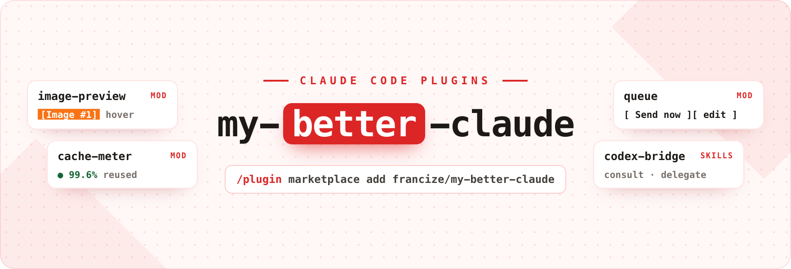
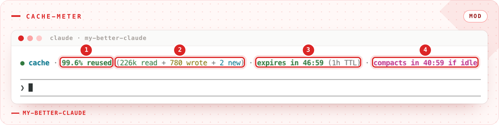
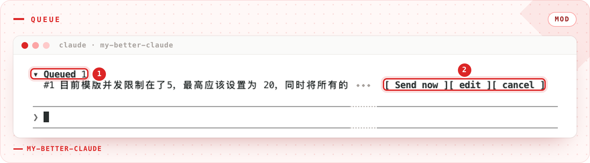

# my-better-claude

[English](README.md) | 中文



一个 Claude Code 插件市场，收录让日常使用更顺手的插件：粘贴图片的预览、你为之付费的 prompt cache 的仪表、一个不会 steer 的消息队列，以及可以与之争论的第二个模型。

## 安装

```
/plugin marketplace add francize/my-better-claude
/plugin install image-preview@my-better-claude
/plugin install cache-meter@my-better-claude
/plugin install queue@my-better-claude
/plugin install codex-bridge@my-better-claude
```

插件彼此独立，按需安装即可。

| 插件                                     | 类型   | 功能                                                                         |
| ---------------------------------------- | ------ | ---------------------------------------------------------------------------- |
| [`image-preview`](plugins/image-preview) | mod    | 鼠标悬停在粘贴的 `[Image #N]` 上预览图片，输入时和已发送的消息里都可以       |
| [`cache-meter`](plugins/cache-meter)     | mod    | 输入框上方的缓存仪表：read / wrote / new token、过期倒计时、未命中原因、会话累计 |
| [`queue`](plugins/queue)                 | mod    | Claude 忙时按 Enter 进入队列而不是 steer；每条可 Send now、edit、cancel        |
| [`codex-bridge`](plugins/codex-bridge)   | skills | 请本地 Codex CLI 评审设计，或在沙箱里把实现交给它                            |

## 插件

### image-preview

![image-preview：指针停在输入框上方的 [Image #1] 上，原图随即浮出](docs/img/image-preview.png)

<sub>① 悬停 `[Image #N]` · ② 浮出它对应的原图</sub>

在输入框或已发送消息中悬停 `[Image #N]` 即可预览：由终端直接绘制（Ghostty、kitty），或在指针旁弹出窗口，或用彩色字符块显示。详见 [插件 README](plugins/image-preview/README.zh-CN.md)。

### cache-meter



<sub>① 命中率 · ② 按 read + wrote + new 拆开的 prompt · ③ 过期倒计时 · ④ 空闲压缩倒计时</sub>

输入框上方的状态条，显示上一次请求的命中率、按 read + wrote + new 拆开的 prompt 和过期倒计时。未命中时写明原因（过期、换了模型或 effort、前缀变了），大上下文缓存过期时提示 `/compact`。详见 [插件 README](plugins/cache-meter/README.zh-CN.md)。

### queue



<sub>① 队列条 · ② 每条都可以 Send now、edit 或 cancel</sub>

Claude 工作时按 Enter，消息会进入输入框上方的队列，而不是插进正在运行的这一轮；这一轮结束后再发出。每条都有 Send now、edit、cancel，也可以用 `/queue <prompt>` 排队。详见 [插件 README](plugins/queue/README.zh-CN.md)。

### codex-bridge


两个 skill，共用一个 `codex exec` 的封装脚本。

| Skill            | 功能                                                                                                     | 沙箱                                                |
| ---------------- | -------------------------------------------------------------------------------------------------------- | --------------------------------------------------- |
| `codex-consult`  | 对抗式设计评审。Claude 先形成自己的立场，给 Codex 一份带 `file:line` 锚点的简报，最多辩论三轮，汇报共识与分歧。 | `read-only`：Codex 不能修改文件                     |
| `codex-delegate` | 委托实现。Claude 负责需求梳理、规划和验证；Codex 负责修改和跑测试，每轮执行计划中的一步。               | `workspace-write`：源文件可写，`.git` 只读          |

两者每个任务只用一个 Codex 线程，后续轮次只需传新内容。详见 [插件 README](plugins/codex-bridge/README.md)。

## 环境要求

- mod 需要 Claude Code 2.1.287+（已在 2.1.304 上验证）；`image-preview` 的悬停需要 `"tui": "fullscreen"`
- `image-preview`：`sips`（macOS）、ImageMagick（Linux），或 PowerShell/ImageMagick（Windows、WSL）；Linux 窗口模式需要 X11 上的 Python Tk
- `codex-bridge`：`PATH` 中有 [`codex`](https://developers.openai.com/codex/cli) CLI（基于 0.154.0 开发）、`jq`、bash 3.2+（macOS 自带 bash 即可）

## 开发

```
claude plugin validate .                              # marketplace
claude plugin validate plugins/<name>
claude plugin test plugins/image-preview
claude plugin test plugins/cache-meter
claude plugin test plugins/queue
```

## codex-bridge：为什么沙箱选择很重要

`codex-delegate` 默认使用 `--sandbox workspace-write` 而不是完全访问，因为这是唯一不依赖模型配合的防线。在 `workspace-write` 下，操作系统让 `.git` 保持只读（`git add` 会报 `.git/index.lock: Operation not permitted`），所以即使模型无视简报里的所有指令，也改不了提交历史。源文件和 `$TMPDIR` 仍然可写；除非传 `--network`，否则不能联网。

这一点比听上去更重要：常见的 Codex 配置会设 `approval_policy = "never"`，没有任何东西会拦下破坏性命令。prompt 里的规则只能降低模型尝试的概率，真正拦住它的是沙箱。

## 许可证

MIT（[LICENSE](LICENSE)）
